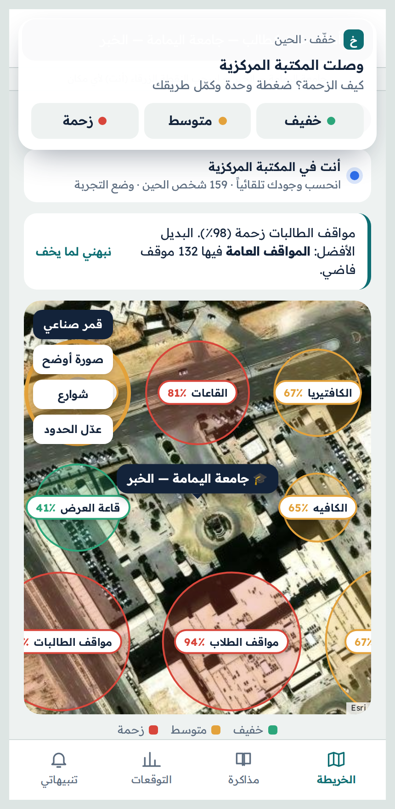
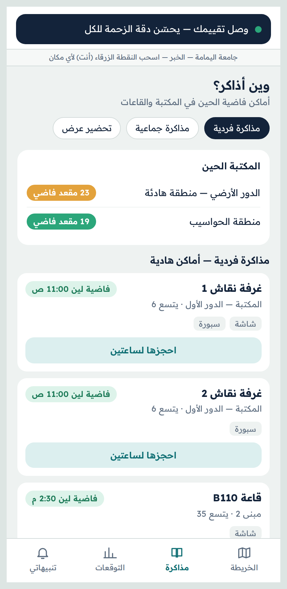
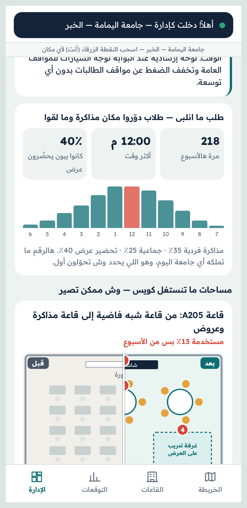
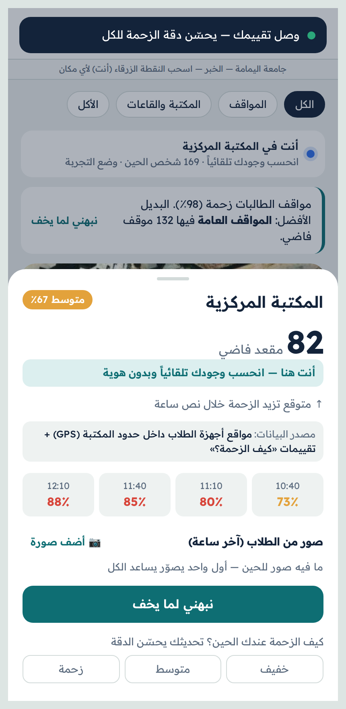
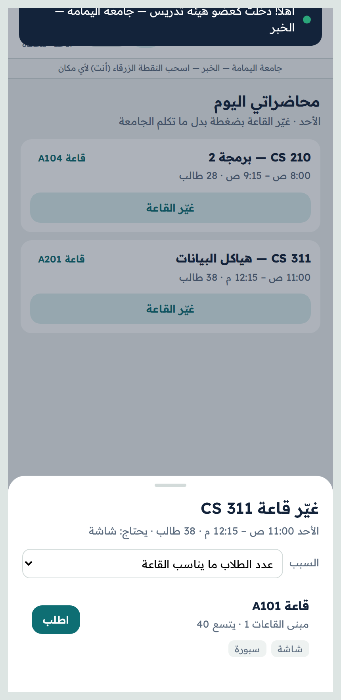
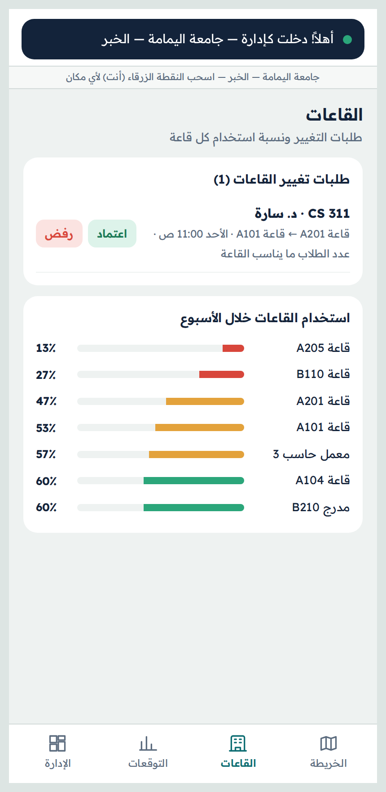
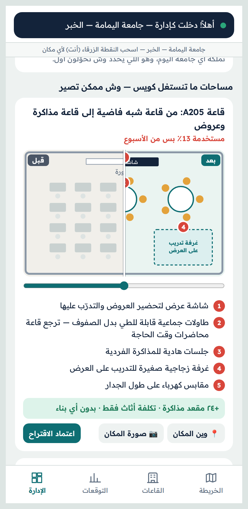
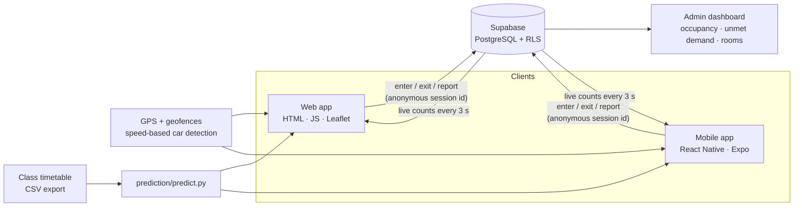

<div align="center">

# خفّف · Khaffif

**Know how crowded it is before you get there.**

A live campus map that shows real-time occupancy of parking lots, the library, study spaces and classrooms — counted automatically from students' phones via GPS, with no new hardware and no personal data.

[**Live demo →**](https://YOUR-USERNAME.github.io/khaffif/) · 🏆 **Top 25 finalist, FARQ Hackathon 2026**

</div>

<p align="center">
  
  
  
</p>

---

## The problem

Every day, students circle full parking lots, walk to a library that is already packed, and queue in cafeterias during short breaks — while other lots, rooms and seats sit empty. Faculty who need a larger room or one with a projector go through emails and waiting. Universities have no data on where demand exceeds supply.

**The problem isn't the crowd. It's that you only find out when you arrive.**

Existing approaches don't scale: per-spot sensors are expensive, cameras raise privacy and approval issues, and consumer maps don't cover the inside of a campus.

## The solution

Khaffif is designed as a feature inside a university's official app. Students sign in once with their university account and opt in. From then on:

1. **Automatic, anonymous counting** — when a phone enters a zone's geofence, the zone's count goes up; when it leaves, it goes down. No name, no student ID, only a random session id.
2. **Car-aware parking** — parking is counted by **cars, not phones**, using GPS speed: entering a lot at driving speed and leaving on foot means a car parked; leaving at driving speed means it left. A student who parks and walks to class keeps their spot counted as occupied.
3. **Timetable forecasting** — the class schedule predicts peaks before anyone shares data, so the app is useful from day one.
4. **One-tap crowd reports** — an optional "How crowded is it?" prompt (Low / Medium / Crowded) refines the estimate.

## Features by role

| Student | Faculty | Facilities / Admin |
|---|---|---|
| Live occupancy map on real satellite imagery | Today's lectures at a glance | Occupancy heat-map per facility |
| Free parking count, with a better alternative suggested | **Change room in one tap**: only rooms free at that slot, large enough, with the required equipment | Approve / reject room-change requests |
| **Study finder**: free library seats and empty classrooms "free until 11:00", by purpose (solo, group, presentation prep) | Request status and automatic student notification on approval | **Unmet demand**: how often students searched for a study space and found none, by hour and purpose |
| Book a discussion room for 2 hours | | Room utilisation ranking for the week |
| Alerts when a place becomes less crowded | | **Before / after concepts** for under-used spaces, with photo upload and numbered change pins |
| Recent student photos of a place | | |

The **closed loop** is the core idea: unmet student demand is measured → admins repurpose under-used rooms → freed rooms appear in the study finder automatically → when faculty move a lecture, the old room is released to students.

<p align="center">
  
  
  
  
</p>

## Architecture



### Technical highlights

- **Geofencing with hysteresis** — a zone is entered at its radius and exited at radius + 15 m, which stops counts flickering at the boundary. When zones overlap, the nearest one (relative to its radius) wins.
- **Speed-based parking detection** — speed comes from the GPS fix or is derived from consecutive fixes; > 3 m/s (~11 km/h) is treated as driving.
- **Presence with expiry** — devices send a heartbeat every 30 s; the `place_counts` view only counts people seen in the last 3 minutes, so closed apps drop out automatically. Parked cars persist up to 12 hours.
- **Shared boundaries** — zone positions edited on the map are stored in Supabase, so every client (web and mobile) uses the same geofences.
- **Timetable model** — parking ≈ students with a lecture within ±1 h; cafeteria ≈ students whose lecture just ended; library ≈ on campus but not in a lecture.
- **Privacy by design** — no names or IDs, location used only inside campus geofences, only aggregated counts stored, aligned with Saudi Arabia's Personal Data Protection Law (PDPL).
- **Zero-dependency web client** — a single HTML file with vanilla JS, talking to Supabase over its REST API; falls back to an offline schematic map if tiles can't load.

## Repository structure

```
khaffif/
├── web/index.html          Full web app (all roles, live data, map editor, judges' screen)
├── mobile/                 React Native / Expo app — see mobile/README.md
├── database/schema.sql     Supabase tables, views and row-level security
├── prediction/
│   ├── predict.py          Hourly crowd forecast from the class timetable
│   └── schedule.csv        Sample timetable
└── docs/                   Screenshots and pitch deck
```

## Run it locally

**Web app** — open `web/index.html` in Chrome. It works offline in simulation mode.

**Live shared data**
1. Create a free project at [supabase.com](https://supabase.com) and run `database/schema.sql` in the SQL Editor.
2. Copy the Project URL and anon key into `SUPABASE_URL` / `SUPABASE_KEY` in `web/index.html` (and `mobile/src/services/api.js`).
3. Open the app on two devices and move into the same zone — both counts update within seconds.

**Mobile app** — see [`mobile/README.md`](mobile/README.md).

**Forecast**
```bash
cd prediction
python predict.py schedule.csv   # writes prediction.csv
```

**Optional** — set `GOOGLE_MAPS_KEY` in `web/index.html` to enable Google satellite imagery (restrict the key to your domain).

## Demo data vs. real data

This is a hackathon prototype. Map imagery, campus locations, GPS detection and live device counts (once Supabase is connected) are real. Crowd percentages in simulation mode, room names and schedules, faculty lectures and the baseline unmet-demand figures are sample data used to demonstrate the flows.

## Roadmap

- Pilot on one campus with a group of students and faculty
- University SSO and official timetable integration
- Background geofencing in the mobile app (development build)
- Wi-Fi signals to distinguish building floors
- AI-generated renders of proposed space changes from uploaded photos

## Team

A team of students from **Al Yamamah University** and **Imam Abdulrahman Bin Faisal University**.

| Name | Role |
|Rawan Alqattan|developing the application|

other team members collaborated in the demo and pitching the idea to the evaluators.

